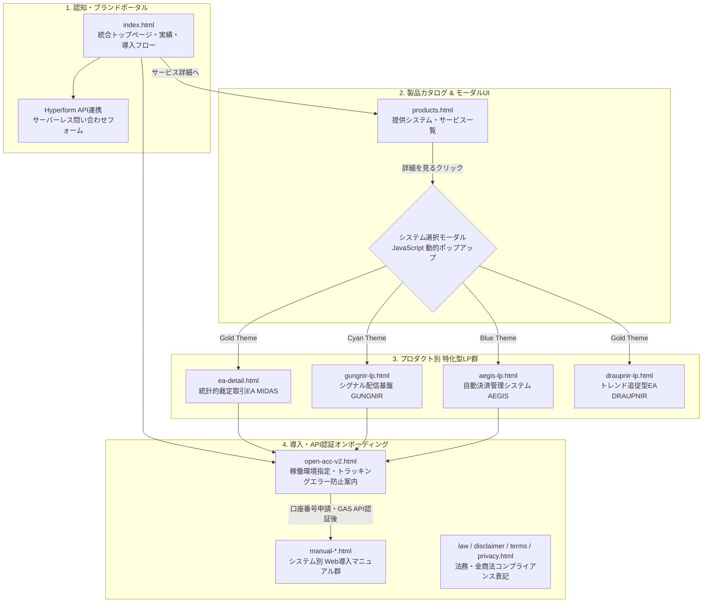

# VALHALLA-Fintech-Web-Portal
### アルゴリズミック取引システム群の統合プロダクトポータル ＆ ユーザーオンボーディングWeb基盤


独自開発した複数の金融アルゴリズムシステム（`MIDAS` / `GUNGNIR` / `AEGIS` 等）の製品仕様公開、導入オンボーディング、および操作マニュアル提供を一元化する静的Webポータルサイト（LP群）です。  
外部フレームワーク（jQueryやBootstrap等）に一切依存しない **Vanilla HTML5 / CSS3 / JavaScript (ES6)** のみでフルスクラッチ構築し、高速なページ表示とデバイスを問わないレスポンシブUIを実現しています。

> **※ ポートフォリオ公開仕様について**  
> 本リポジトリでは、実運用しているWebポータルのうち、フロントエンドのUI設計および導線アーキテクチャを示す主要ページ（ポータル・製品カタログ・個別LP・オンボーディング画面）のソースコードを抜粋して公開しています。

---

## 📸 サイト画面・UIプレビュー

### 1. ブランド統合ポータル（`index.html`）＆ プロダクト選択モーダル（`products.html`）


### 2. プロダクト別特化型LP（`ea-detail.html` [MIDAS] / `gungnir-lp.html` [GUNGNIR]）


https://github.com/user-attachments/assets/6180539a-9c0a-4105-ab67-17d1aefa62e1


---

## 🏗 サイトマップとユーザージャーニー（導線設計）

認知（トップページ）から製品比較（動的モーダル）、仕様理解（個別LP）、環境構築・API認証申請（オンボーディング）までをシームレスに誘導するファネル構造を設計しています。


🔗 連携するバックエンド／アルゴリズム開発リポジトリ
本Webポータルで紹介・提供している各システムのソースコードおよびアーキテクチャ設計書は、以下の各リポジトリにて公開しています。

MIDAS-Gold-Silver-Arbitrage-EA

金銀比価のZスコア（標準化スコア）を用いた統計的裁定取引EA（ea-detail.html 対応プロダクト）

Odins_GUNGUNIR_GOLD-framework

MTF環境認識 ＆ チャート画像バイナリ付きDiscord非同期配信基盤（gungnir-lp.html 対応プロダクト）

AEGIS-Position-Manager

イベント駆動型GUI ＆ ステルス・バスケット決済管理システム（aegis-lp.html 対応プロダクト）

fx-economic-indicator-notifier

GAS × Webスクレイピングによる重要経済指標の自動収集・Discord通知ボット

💡 フロントエンド設計・UI/UXの工夫
1. IntersectionObserver API を用いた高パフォーマンスなスクロール演出
課題: 従来の window.addEventListener('scroll', ...) によるスクロール位置監視は、メインスレッドに高負荷をかけ、スマートフォン等での描画カクつき（ジャンク）の原因となる。

解決策: ブラウザネイティブの IntersectionObserver API を採用し、要素がビューポートに交差した瞬間のみ .show クラスを付与する非同期監視を実装。CSSの transition-delay（.delay-1 〜 .delay-4）と組み合わせることで、外部ライブラリを一切使わずに滑らかな時間差フェードイン演出を実現。
```
// IntersectionObserverによる軽量なスクロール連動アニメーション制御
const observer = new IntersectionObserver((entries) => {
    entries.forEach((entry) => {
        if (entry.isIntersecting) {
            entry.target.classList.add('show');
        }
    });
});
document.querySelectorAll('.fade-in').forEach((el) => observer.observe(el));
```
2. プロダクト別のブランドカラー設計とグラスモーフィズム・モーダルUI
設計意図: 複数の異なる特性を持つシステム（裁定取引・サイン配信・決済補助）をユーザーが直感的に識別できるよう、プロダクトごとに明確なカラーシステムを定義。

MIDAS（フラッグシップ）: Gold (#d4af37) × Dark Gray

GUNGNIR（シグナル基盤）: Cyber Cyan (#00f2fe) × Deep Navy (#080b12)

AEGIS（防衛・決済管理）: Shield Blue (#3b82f6)

products.html のシステム選択モーダルでは、backdrop-filter: blur(5px) を用いたすりガラス効果（グラスモーフィズム）を採用し、ホバー時に各システムのテーマカラーが発光するマイクロインタラクションを実装。

3. ユーザーの導入離脱・設定ミスを防ぐオンボーディングUX（open-acc-v2.html）
課題: ユーザーがシステムを導入する際、ブラウザのトラッキング防止機能（AdBlockやBrave等）による紐付けエラーや、口座スペック（通貨単位・レバレッジ等）の選択ミスによるサポート工数の増大が発生しやすい。

解決策: 導入ページ内に視覚的なスペック指定グリッド（.spec-grid）と、Cookie切れ・広告ブロッカー干渉を事前防止するアラートUI（.tracking-alert）を配置。これにより導入時の設定ミスと問い合わせコストを大幅に削減。

4. モバイルファーストを意識したレスポンシブ・レイアウト制御
CSS FlexboxおよびGrid Layoutを活用し、@media (max-width: 768px) ブレイクポイントでPC用の2カラム交互配置（.feature-card.reverse 等）を自然な1カラム縦積みレイアウトへ自動変換。

スマートフォン閲覧時にはヘッダーのサブCTAボタン（.header-btn）を display: none で隠して画面占有を防ぎ、ファーストビューのメインCTAへ視線を集中させる画面設計を採用。

🛠 技術スタック
マークアップ / スタイリング: HTML5 / CSS3 (Flexbox, CSS Grid, Custom Keyframes/Transitions, Media Queries)

フロントエンド制御: Vanilla JavaScript (ES6) (IntersectionObserver API, DOM Event Modal Control)

外部連携 / インフラ: GitHub Pages (Static Hosting) / Hyperform API (Serverless Form Handling) / LINE Official Account

コンプライアンス設計: 特定商取引法表記・免責事項・金融商品取引法（投資助言業非該当の明示）対応レイアウト

📁 ディレクトリ構成
```
VALHALLA-Fintech-Web-Portal/
│
├── assets/                        # サイトプレビュー・各種バナー画像格納用
│   ├── portal_top_preview.png     # トップページ＆モーダル画面キャプチャ
│   └── product_lp_preview.png     # 個別システムLP画面キャプチャ
│
├── src/                           # フロントエンド主要ソースコード
│   ├── index.html                 # ブランド統合ポータル（トップページ）
│   ├── products.html              # 製品一覧カタログ（動的モーダル搭載）
│   ├── ea-detail.html             # フラッグシップEA「MIDAS」特化型LP
│   ├── gungnir-lp.html            # シグナル基盤「GUNGNIR」特化型LP
│   └── open-acc-v2.html           # 導入オンボーディング・環境構築ガイドページ
│
└── README.md                      # サイト設計・UI/UXアーキテクチャ解説書
```
